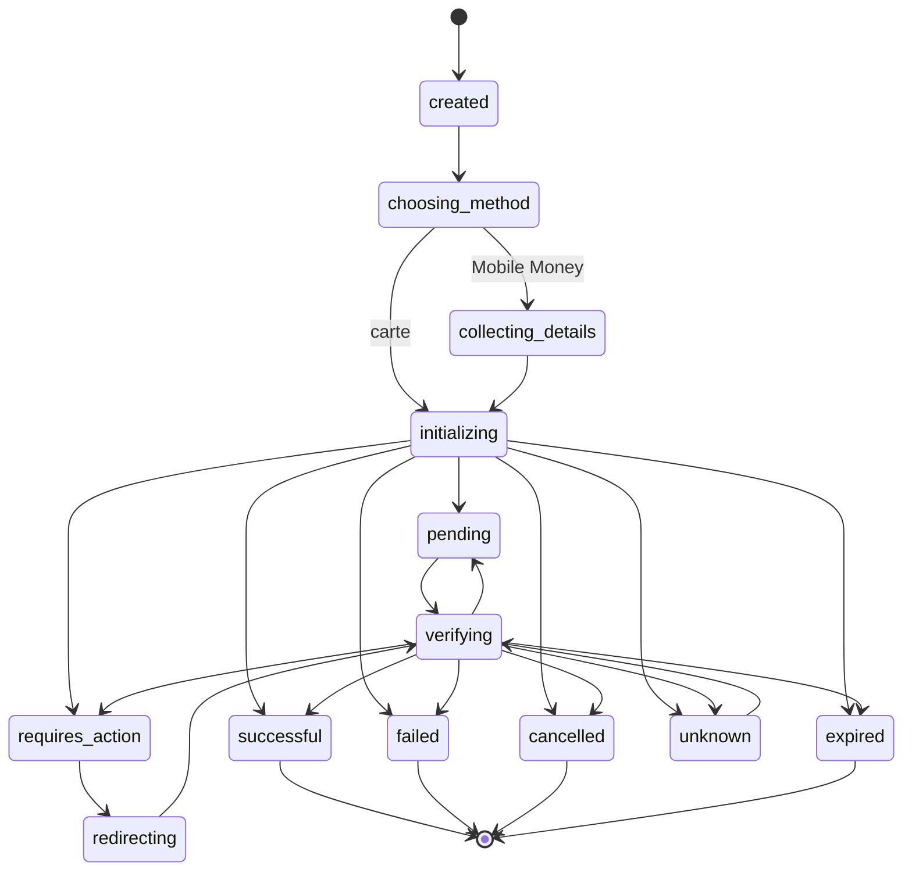

# Machine à états du checkout

Le statut brut FlexPay, `NormalizedPaymentStatus` et `CheckoutState` sont trois informations distinctes. Un retour navigateur ne modifie jamais directement le statut normalisé.

## Invariants

- `successful`, `failed`, `cancelled` et `expired` sont terminaux.
- `successful` ne peut jamais être dégradé.
- Une réponse réseau ambiguë produit `unknown` ou conserve `pending`, jamais `failed`.
- Une initialisation fournisseur n’est jamais retentée automatiquement.
- Un callback dupliqué retourne l’état courant sans réémettre les effets métier.
- Un événement horodaté plus ancien que la dernière observation fournisseur est ignoré.
- Une transition interdite lève `InvalidCheckoutTransitionException`.
- Chaque transition est sauvegardée avant l’émission de l’événement applicatif.

`unknown` n’est pas terminal : l’utilisateur peut reprendre la vérification avec le même `checkoutId` et la même référence marchande.
